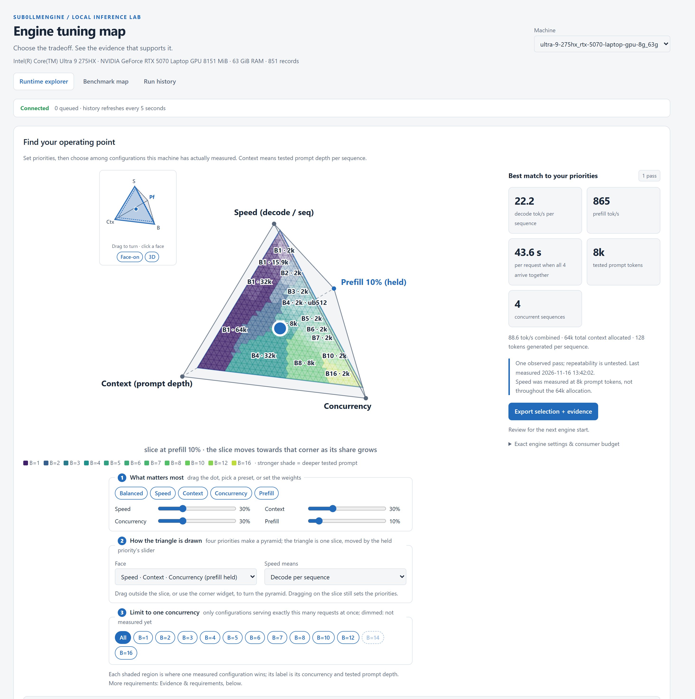
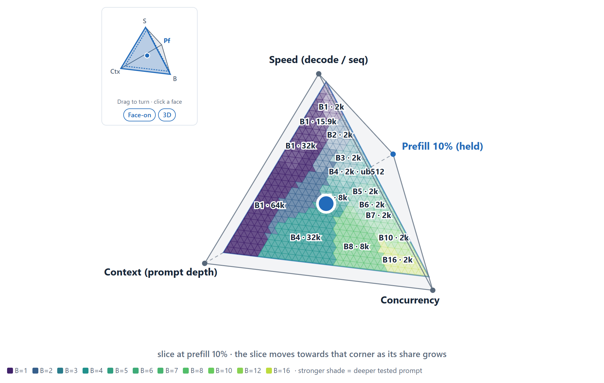
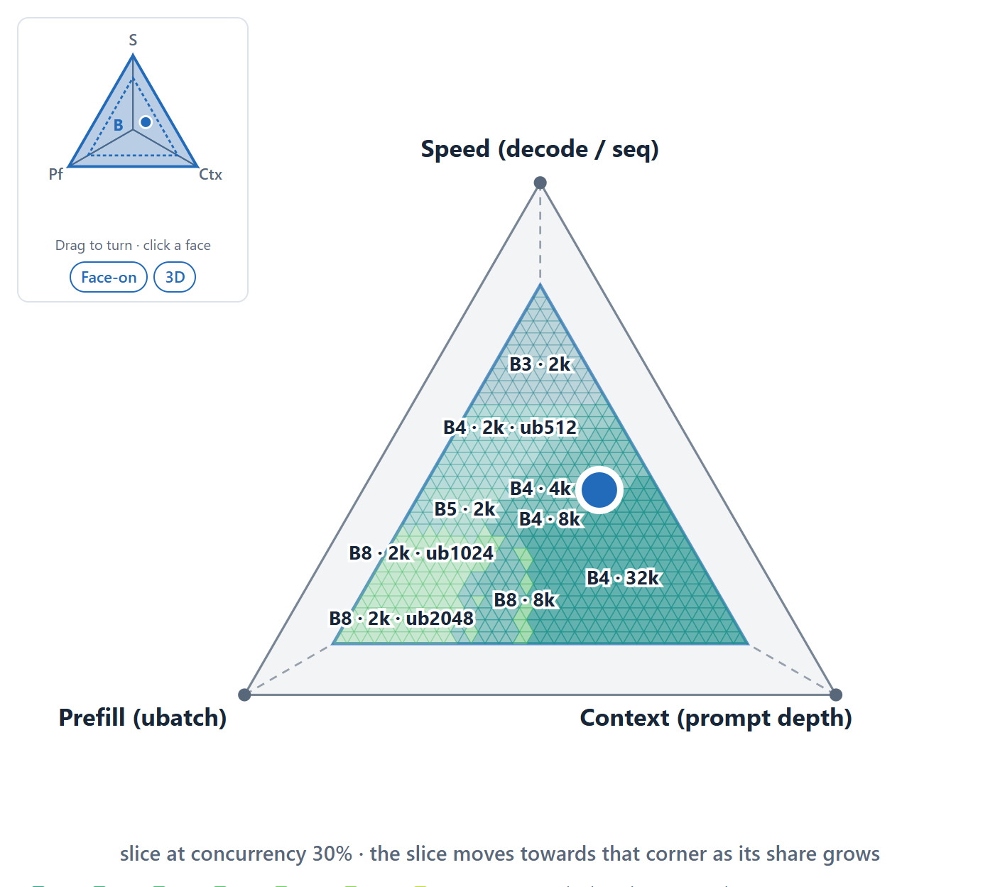
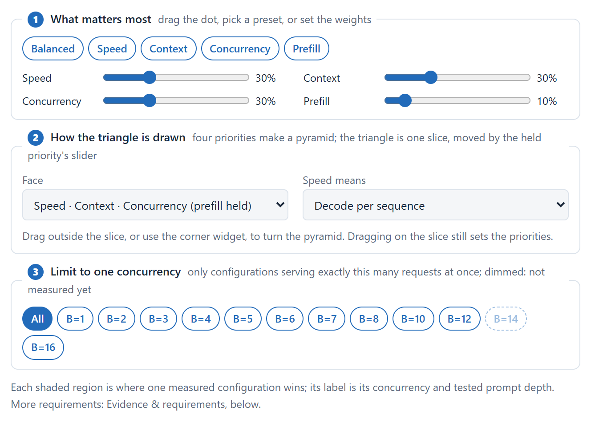
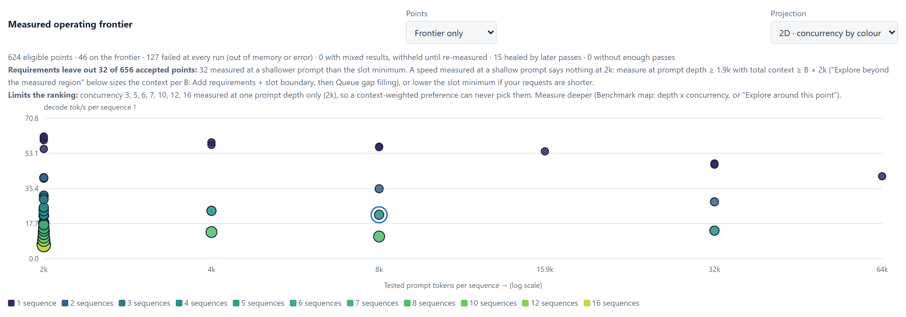
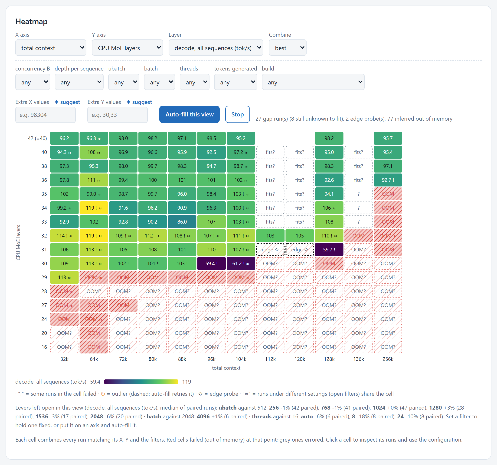
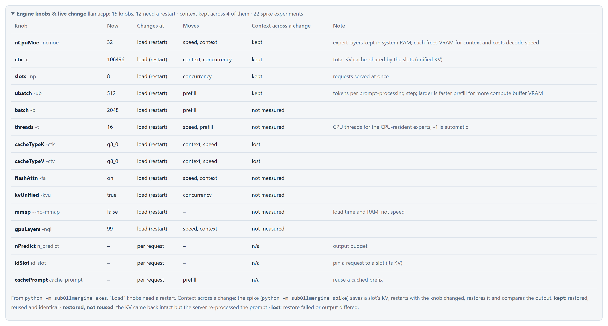

# Sub0LlmEngine

Run, measure and tune local LLM inference engines on the machine you have, and choose a configuration from evidence.



It takes the engine boilerplate out of the projects that use a model (first [Sub0Squad](https://github.com/CraigHutchinson/Sub0Squad)):
one place that knows how to start an engine with the right placement for *this* machine, how fast each configuration
really is, and where the weights are. Backends: **llama.cpp** today; strata and Sub0Llm are planned behind the same
interface (`sub0llmengine/backends/`). Python 3.10+, standard library only. Windows and Linux (including WSL).

* **Measure** every configuration, failures included, into a per-machine history (`bench/<machine>.jsonl`).
* **Fill the map automatically**: auto-fill infers which settings must run out of memory, bisects to the edge and proves it.
* **Choose by priority**: drag a point in a 3D priority pyramid; the page recommends only configurations that were measured.
* **Describe the engine** as runtime axes and knobs (`python -m sub0llmengine axes`), and measure which knobs can change
  mid-job without losing a sequence's context (`python -m sub0llmengine spike`).
* **Serve** the chosen configuration as an OpenAI-compatible endpoint on 127.0.0.1.

## Quick start

```sh
python -m sub0llmengine machine          # this machine's id (the bench history file name)
cp config/engine.defaults.json engine.local.json    # then edit: binDir, model, placement (keep only the keys you change)
python -m sub0llmengine config           # the effective configuration and the server command it makes
python -m sub0llmengine serve            # the tuning page: http://127.0.0.1:8781/
python -m sub0llmengine sweep --ctx 65536,131072 --ncmoe 32,36,40 --depth 2048 --B 1,4,8
python -m sub0llmengine start            # serve the chosen configuration (OpenAI-compatible, 127.0.0.1)
python -m sub0llmengine status           # slots, context per slot, and the line to give a client (--json for programs)
python -m sub0llmengine stop
```

A bench needs the whole GPU, so `sweep` refuses while the engine is running, and every bench takes `out/bench.lock`.

## The tradeoff

On a machine whose GPU cannot hold the whole model, four things trade against each other through one memory budget:

| Axis | Measured as | Moved mostly by |
|---|---|---|
| **Speed** | decode tok/s per sequence (or whole requests per minute) | CPU MoE layers / GPU layers, threads, KV type |
| **Context** | tested prompt depth per sequence | total context `ctx`, KV type, placement |
| **Concurrency** | sequences decoding at once (B, the server's slots) | slots, `ctx` |
| **Prefill** | prompt tok/s | micro-batch `ubatch`, batch |

Every point is measured, failures included, so the working region and its edge build up over successive runs.

## The runtime explorer

`python -m sub0llmengine serve` opens the tuning page. Four priorities are the corners of a tetrahedron; any weighting is
a point inside it. The triangle is the slice where the held priority keeps its share, drawn inside the tetrahedron.
Each shaded region is where one measured configuration wins (colour: concurrency; shade: tested prompt depth); hover
names its exact settings, click or drag to choose.

<p align="center"></p>

Drag outside the slice, or use the corner widget, to turn the pyramid; click a widget face to look at another slice
(for example speed, context and prefill with concurrency held). *Face-on* flattens the view.

<p align="center">


</p>

The controls under the plot follow the order you use them: what matters most (presets and four sliders), how the
triangle is drawn (face, what "speed" means), and an optional limit to one concurrency. Ranking is on a log scale per
axis with an augmented Chebyshev score, so every frontier point is the best for some weighting and moving the dot walks
through the measured concurrencies in order. Requirements (evidence repeats, minimum prompt, decode or prefill floors,
the slot minimum) are filters in one registry (`TuningEvidence.FILTERS`); the summary says what each removes.

The recommendation card shows decode, prefill, time per request and the evidence behind it. *Export selection +
evidence* downloads a proposal that the command line receives without starting anything:

```sh
python -m sub0llmengine selection engine-selection.json --out chosen.engine.json
python -m sub0llmengine --config chosen.engine.json start
```



## The benchmark map and auto-fill

Any two axes (CPU MoE layers, total context, concurrency, depth, ubatch, threads, KV type, model, build), a layer to
colour by (decode, prefill, peak VRAM, works/fails, runs), filters for the rest. Hatched red cells ran out of memory.



*Auto-fill this view* measures the empty cells until none are left. A configuration needing at least as much memory as
one that failed must fail too (`OOM?`), one needing no more than one that worked fits (`fits?`); undecided cells are
measured in the order that settles the most others, so the memory edge is found by bisection. `OOM?` cells beside a
measured success are probed so the edge is proved, and failures heal once two later runs needing as much memory
succeed. The "levers" line names the knobs left open in the view and what each did in paired runs. The same from the
command line: `python -m sub0llmengine auto --x ctx=32768,65536,131072 --y nCpuMoe=30,32,34,36,40 --B 1,4,8 [--plan]`.
Select a cell to drill around it, or save its configuration for the next engine start.

Records taken while something else loaded the machine can be excluded without deleting them:
`python -m sub0llmengine exclude --since T1 --until T2 --reason "..."`. *Run history* shows every run over time.

## Runtime axes, knobs and changing configuration mid-job

`python -m sub0llmengine axes` prints one simplified, backend-neutral definition (`sub0llmengine.axes.v1`, also at
`/api/axes`): the four axes with their metrics and the knobs that move them; the workload dimensions (depth, B, ntg); and
each knob with its flag, type, range, unit, current value, whether it changes at **load** (a restart) or per
**request**, and whether a sequence's KV survives a change of it. The page reads it for the knobs that identify a
measured point, so a new backend needs no page change.



`python -m sub0llmengine spike` measures that last column. Per transition A to B it prefills a prompt in A, saves the
slot's KV (`/slots/0?action=save`), restarts in B, restores it, continues the prompt, and compares token for token with
B computing everything itself (temperature 0); a control repeats the split prefill inside B when they differ.
`--list`, `--only`, `--tokens`, `--model` and `--set KEY=VALUE` shape a run; results go to `out/spike/reconfigure.jsonl`.

Results on the reference machine (16k-token prompt, 64-token follow-up; llama.cpp upstream `c7518db`):

| Model | Knob changed | KV restored | Reused (tokens recomputed) | Output identical | Switch cost | Prefill avoided |
|---|---|---|---|---|---|---|
| Qwen3.6-35B-A3B (hybrid) | ubatch, ctx, slots, CPU MoE layers | yes | yes (64) | yes | 7.3 s | 15.5 s |
| Qwen3.6-35B-A3B | KV type q8_0 to q4_0 | refused | | | | |
| Qwen2 0.5B (attention only) | ubatch, ctx, slots | yes | yes (64) | yes | 1.3 s | 0.9 s |

So a job can prefill under a prefill-tuned configuration (ubatch 2048, one slot: 10.0 s for 16k tokens against 19.6 s
at the serving configuration) and then move to the serving configuration with its context intact. With a restart of
about 7 s, switching pays from about 14k prompt tokens. On the older reference build (b9413) hybrid models restored
correctly but re-processed the prompt (ggml-org/llama.cpp#24110 fixed the reuse rule). The backlog's
*Workload-adaptive engine configuration* section takes this further.

## Using the engine from another project

A consumer (first [Sub0Squad](https://github.com/CraigHutchinson/Sub0Squad)) keeps its own config layer and drives the
engine through the command line; every command that reports takes `--json`.

```sh
python -m sub0llmengine --config squad.engine.json start --json   # progress on stderr, the description below on stdout
python -m sub0llmengine --config squad.engine.json status --json  # exit 1 when nothing answers
python -m sub0llmengine --config squad.engine.json stop           # waits until the server has gone
python -m sub0llmengine model qwen38-27b-q4_0                     # registry id, file path, GGUF facts (KV bytes per token, ...)
python -m sub0llmengine --config squad.engine.json config --json  # layers, model, build label and the exact server command
```

`status --json` and `start --json` print one document (`sub0llmengine.engine.v1`):

| Field | Meaning |
|---|---|
| `running`, `url`, `health` | whether the server answers; the OpenAI-compatible base URL (`.../v1`) and its health URL |
| `alias`, `slots`, `busy`, `nCtxPerSlot` | the model name to send, the server's slots and how many are busy, its context per slot |
| `squadCtx` | the context a client should plan per request (the config's `squadCtx`, else `nCtxPerSlot`) |
| `startedByThisTool` | `start` recorded this engine in `out/engine.json`; the fields below come from that record |
| `model`, `build`, `config`, `command`, `startedAt` | registry id and file path, `git describe` of the llama.cpp build, the effective settings and exact command |
| `matchesConfig`, `differences` | whether the answering engine was started with the settings now configured; else `{key: [running, configured]}`. `null` when something else answers on the port |
| `benchLock` | the pid holding the bench's GPU lock, when a bench is running |

Rules a consumer can rely on:

* `start` exits 0 when an engine answers (already, or started and ready), 1 when it failed to start (the log's tail is
  printed), 2 when a bench holds the GPU (`out/bench.lock`). It never starts a second engine on a port that answers:
  check `matchesConfig`, and `stop` then `start` to apply other settings.
* `stop` only stops an engine this tool started (exit 1 if another one answers there) and waits for it to go.
* Benches (`sweep`, `auto`, `spike`) refuse while the engine answers; `start` refuses while a bench runs.
* Record `model.id`, `build` and `config` with every result, so each one names its exact weights, build and settings.
* The tuning page's *Export selection + evidence*, received with `selection FILE --out LAYER`, is a config layer like
  any other: pass it with `--config`.

## Configuration

Layers, later wins: `config/engine.defaults.json` < `engine.local.json` (gitignored, this machine) < `$SUB0LLMENGINE_CONFIG`
< `--config FILE`. Changes made from the page go to the top layer.

| Key | Meaning |
|---|---|
| `backend` | `llamacpp` (default) |
| `binDir` | folder with `llama-server` and `llama-batched-bench` (any build; flags are adapted to it) |
| `model`, `registry` | a registry alias or id, or a plain file path; the registry folder (`$SUB0_MODEL_REGISTRY` wins) |
| `host`, `port`, `alias` | where the server listens and the model name it answers to |
| `ctx`, `slots`, `kvUnified` | total context, server slots, one KV pool shared by the slots |
| `nCpuMoe`, `gpuLayers` | MoE layers whose experts stay on the CPU; layers on the GPU |
| `ubatch`, `batch`, `threads` | micro-batch, logical batch, CPU threads |
| `cacheTypeK/V`, `flashAttn`, `mmap` | KV cache quantization, flash attention, memory-mapped load |
| `ctxCheckpoints`, `cacheRam` | per-slot context checkpoints (prompt reuse on hybrid models), host prompt cache MiB |
| `squadCtx` | the context a client should plan per request (printed by `status`) |
| `extraArgs` | passed to the server as-is |

## Model registry

Models come from a [Sub0LlmModelRegistry](https://github.com/CraigHutchinson/Sub0LlmModelRegistry) folder such as
`D:\LlmModels`: `model` is an alias or id there (or a plain file path). With the `sub0llmregistry` package importable
(installed, or a sibling checkout `../Sub0LlmModelRegistry`) it resolves ids and supplies facts read from the GGUF
header (layers, expert bytes per layer, KV bytes per token); without it, the folder's `registry.json` is read directly.
Fetching models belongs to the registry: `python -m sub0llmregistry fetch hf:<org>/<repo>#<file>` (it asks first).

## Results, known issues and design notes

* [docs/RESULTS.md](docs/RESULTS.md): Intel Core Ultra 9 275HX, RTX 5070 Laptop (8 GB), 64 GB, Qwen3.6-35B-A3B.
* [docs/TUNING_MAP.md](docs/TUNING_MAP.md): the selection rules, evidence boundaries and the consumer contract.
* [docs/BACKLOG.md](docs/BACKLOG.md): next work, including resource allowances and workload-adaptive configuration.
* [docs/sessions/](docs/sessions/README.md): handoff docs, a self-contained brief per follow-up task.
* Known issues, being isolated before reporting upstream:
  [Qwen3.8-27B UD-IQ3_XXS garbage with CUDA offload (Q4_0 is fine)](docs/issues/qwen38-27b-cuda-offload.md) and
  [Qwen3.8-Flash-Next run-to-run differences on long prompts](docs/issues/qwen38-flash-next-nondeterminism.md).

Benchmarks establish observed throughput at a particular workload, not output quality, live headroom or a guarantee at
untested depths. Allocated context is not measured prompt depth.

## Development

```sh
python -m unittest discover -s tests      # Python: selection, auto-fill, axes, process control and the client contract (no GPU)
node --test tests/tuning-selection.test.cjs   # the page's selection core
node tools/capture-readme.mjs             # regenerate docs/images from a running tuning page (headless Edge/Chrome)
python tools/sanity.py MODEL BINDIR 0,4,12,22   # plain completions at several GPU offloads
```

## Licence

MIT, see [LICENSE](LICENSE).
